# Companion Tutorial on Continuous Wavelet Transform - Fault Diagnosis with CNN, ResNet, CNN-SVM, CNN-BiGRU, and CNN-LSTM

If the following images do not display, you can refer to gzh: Tao Code. Search for the article title to find it! "Housekeeping-level tutorial on Continuous Wavelet Transform - Fault Diagnosis of CNN, ResNet, CNN-SVM, CNN-BiGRU, and CNN-LSTM" in MATLAB code.
This time, we bring to you:
CWT-CNN, CNN-SVM, CWT-ResNet, CWT-CNNBiGRU, CWT-CNNLSTM.  
Content Summary
Process the official download of Xi'an Jiaotong University data. The method for processing is referred to in previous articles: Xi'an Jiaotong University bearing diagnosis data processing, free MATLAB code obtained;
② Utilize Continuous Wavelet Transform (CWT) to convert the bearing dataset into a time-frequency diagram, extracting both frequency and time domain information, thereby providing more detailed features for subsequent fault diagnosis.
③ To facilitate the training of the model and considering the memory capacity of the computer, the time-frequency diagram is resized to 64×64×3 dimensions, and the extracted feature data are saved.
④ Construct separate models: CNN, ResNet, CNNBiGRU, CNNLSTM, CNNSVM. Feed the feature data into the models and use 70% of the data as the training set and 30% as the test set to train and test the models.
The CWT-CNN model structure is as follows:
Content details
1. Process the official download of Western Reserve University data as follows:
Load a total of 10 data sets, then select the DE_time (%DE is driver-side data, FE is fan-side data, and BA is acceleration data) for each data set.
2. Set the sliding window w, the number of faulty sample points s for each data point, and the sample quantity m for each fault type.
After all the data sliding windows are completed, consolidate them into a single data variable.
The processing of data from Xichu University is covered in a previous article, which can be accessed here: Xichu University Bearing Diagnosis Data Processing with MATLAB Free Code.

The final processed data is a 1000*2048 matrix, where 1000 represents the sample size and 2048 denotes the number of features. This equals to 1000 samples for 10 different fault states, each with 100 samples. The code file is named data_total_1797.mat.

Step two involves using continuous wavelet transform to convert the data into time-frequency plots.

Continuous Wavelet Transform (CWT) Time-frequency plot:

Step three involves feeding the constructed feature vectors into various models for training and testing.
For each state, the first 70 samples are used for training, and the last 30 samples for testing. The results are as follows:
ResNet architecture:
Before and after adding T-SNE dimensionality reduction:
All code directories screenshots:

To execute the program, follow the steps outlined in the instructions. The .txt file provides detailed instructions on how to proceed with the program.

All images can be run successfully.
This article is consistent with the previous tutorial on Continuous Wavelet Transform - CNN, ResNet, CNN-SVM, CNN-BiGRU, CNN-LSTM for fault diagnosis, using the Kaisik University bearing data.

CWT-CNN, CNN-SVM, CWT-ResNet, CWT-CNNBiGRU, CWT-CNNLSTM.

Introductory content:
①Process the Jiangnan University bearing data.
②Convert the bearing dataset through Continuous Wavelet Transform (CWT) into a time-frequency plot to extract frequency domain and time domain information, providing more detailed features for subsequent fault diagnosis.
③ To facilitate the training of the model and considering the computer's memory, the time-frequency graph is resized to 64×64×3 dimensions and the extracted feature data are saved.
④ Build separate models: CNN, ResNet, CNNBiGRU, CNNLSTM, CNNSVM, feed the feature data into the models, 70% of the data as training set, 30% as test set, and conduct training and testing on the models.
Detailed explanation:
I. Process the official downloaded data from Xiu University, with the following steps:
1. Load four types of data, in this case, taking the normal, inner ring, outer ring, and rolling element states;
2. Set the sliding window w, the number of fault samples points s for each data, and the sample quantity m for each fault type;
3. After all the data sliding windows are completed, integrate them into a single data variable;
4. Finally, the obtained data is a 400*2048 matrix, where 400 is the sample size, 2048 is the feature size. 400 also equals 100*4, 4 refers to the four fault states, 100 refers to each state has 100 samples. In the code, it is data_total.mat
II. Conduct continuous wavelet transform to convert data into time-frequency graphs
Continuous wavelet transform time-frequency graphs, this example uses 1000rpm as an example.
III. Feed the built feature vectors into different models for training and testing
Use the first 70 groups for training and the last 30 groups for testing for each state. The results are as follows:
ResNet structure:
Added T-sne dimensionality reduction before and after distribution diagrams for each state:
Follow the program steps step by step to execute, which explains.txt provides detailed instructions on how to execute the program.
All images can be run out.
Code directory:
Divided into Xiu University data and Jiangnan University data

## Images

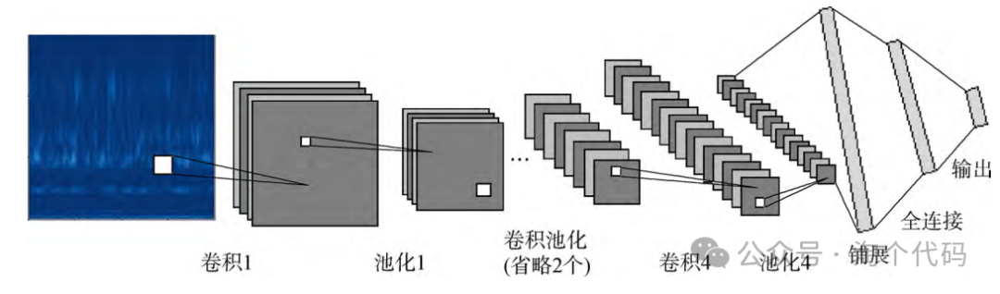
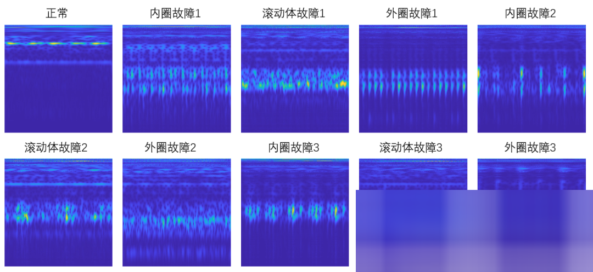
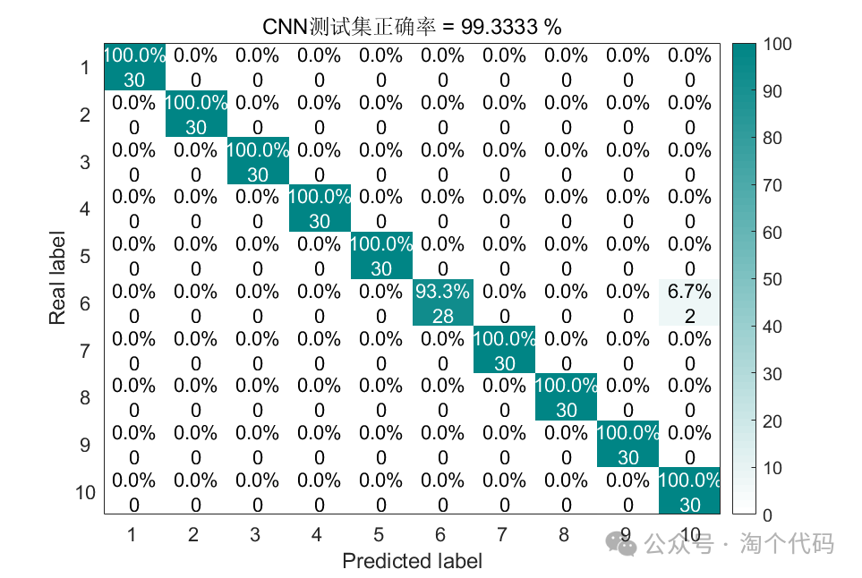
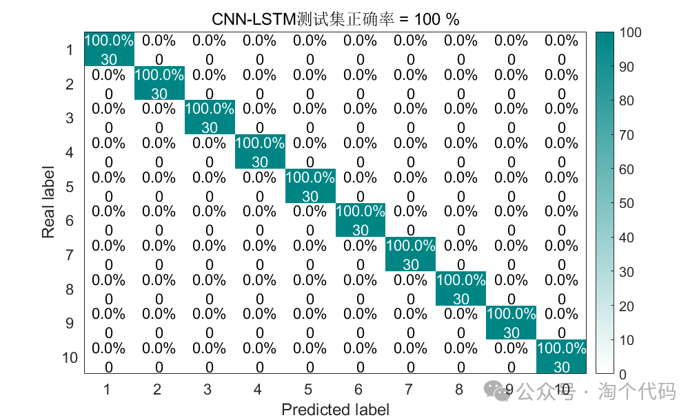
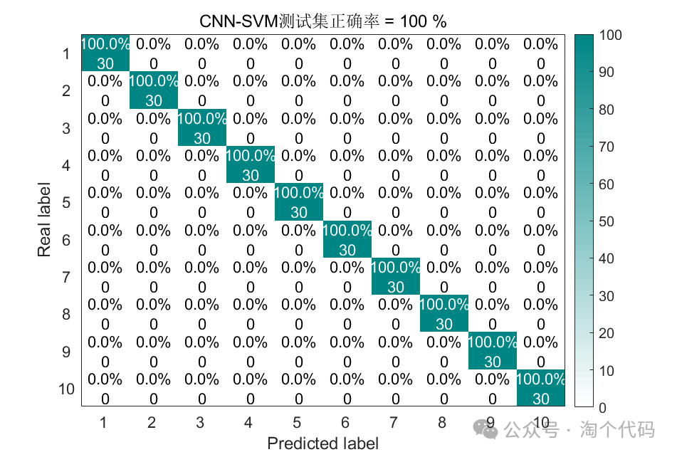
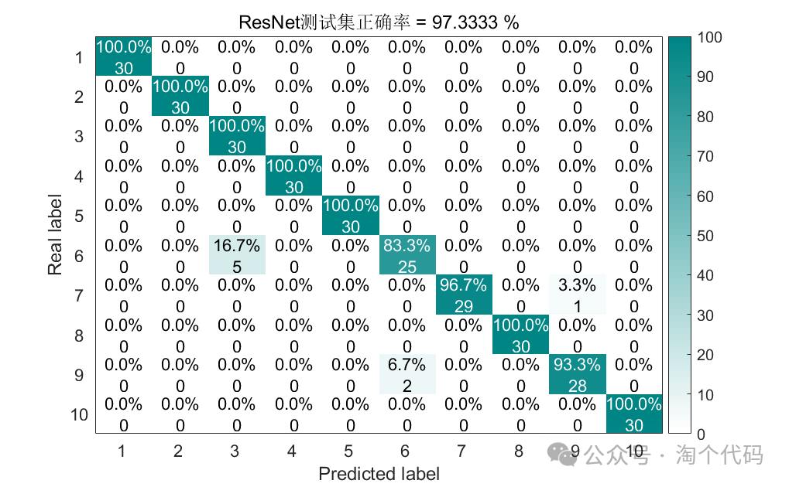
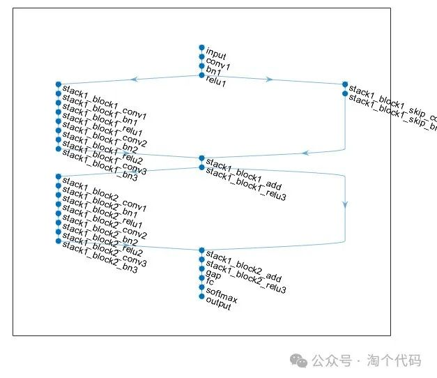
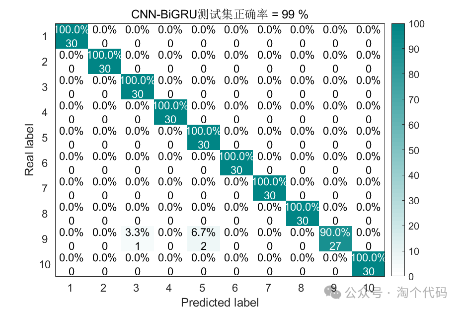
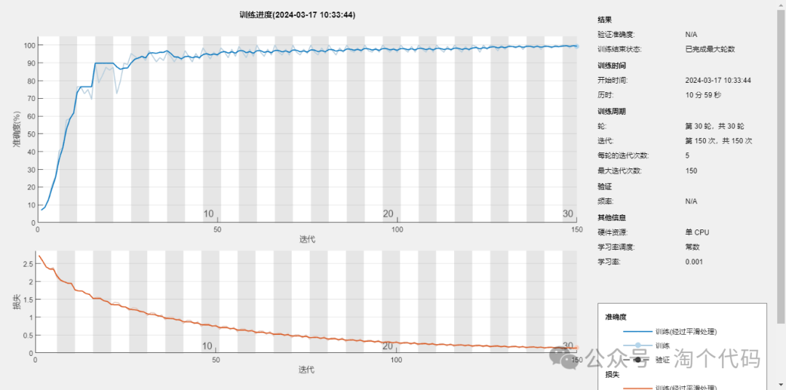
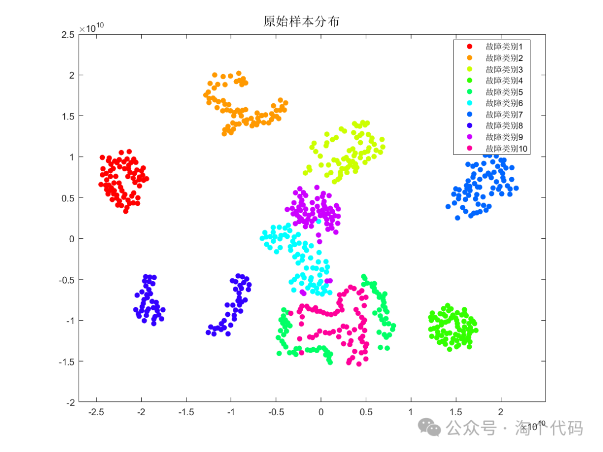
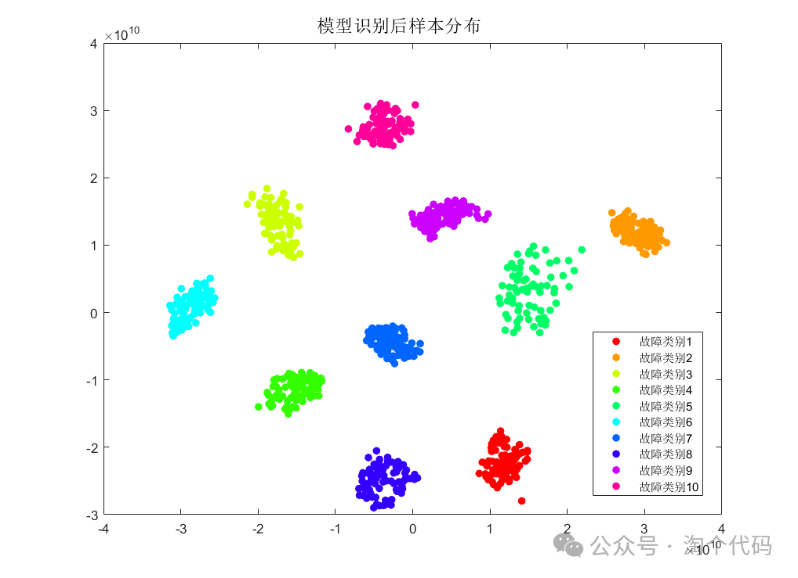
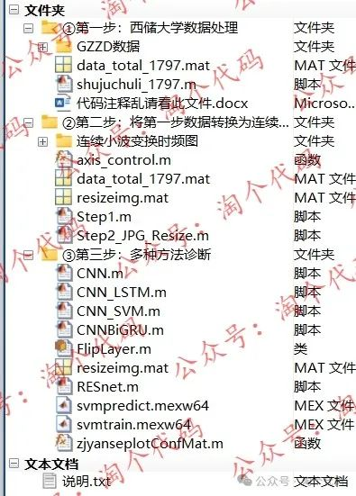
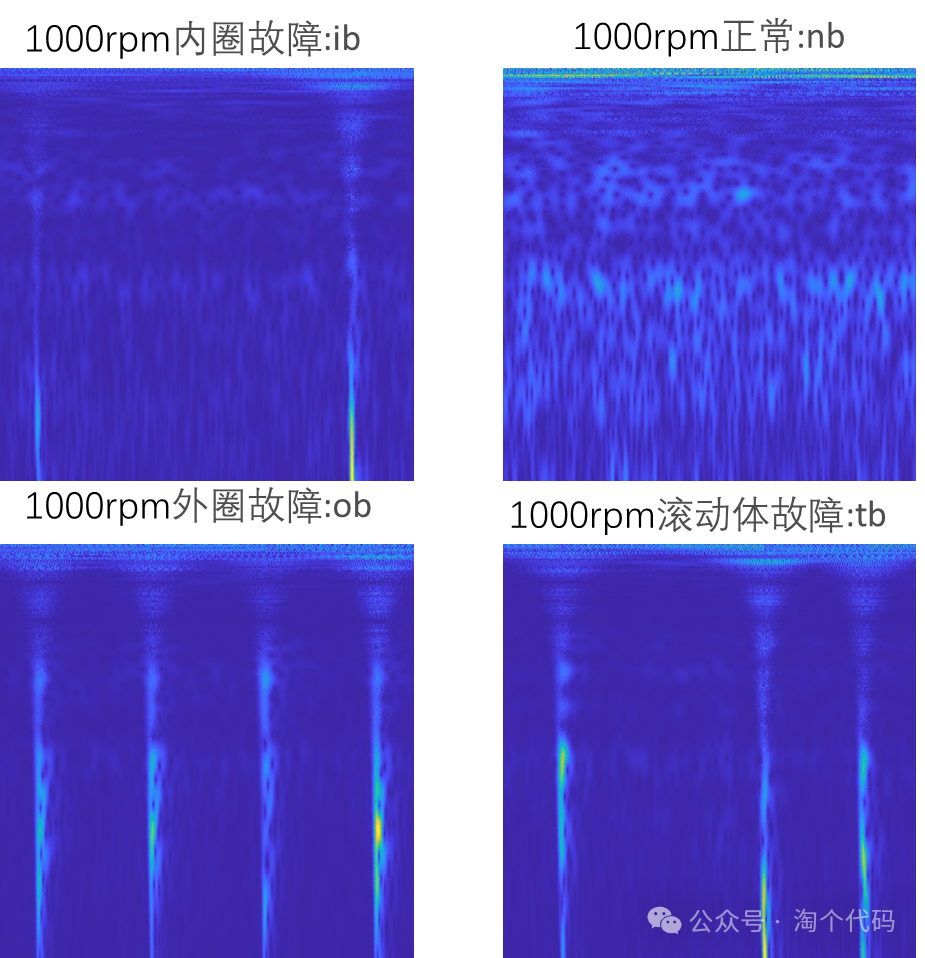
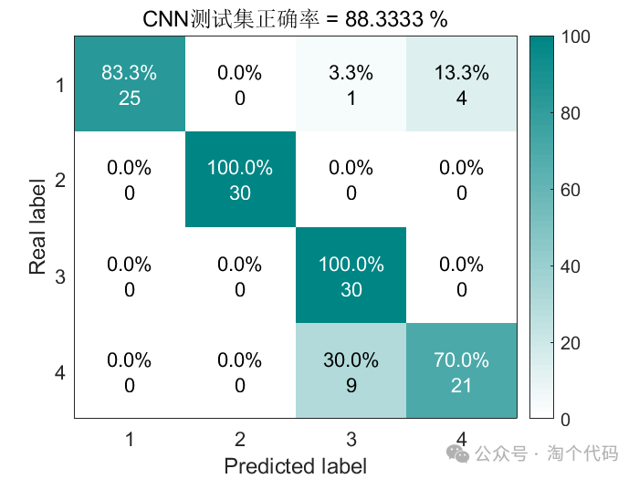
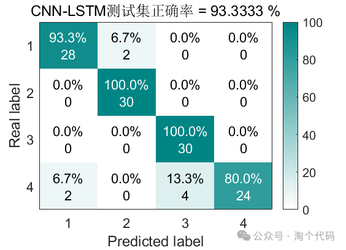

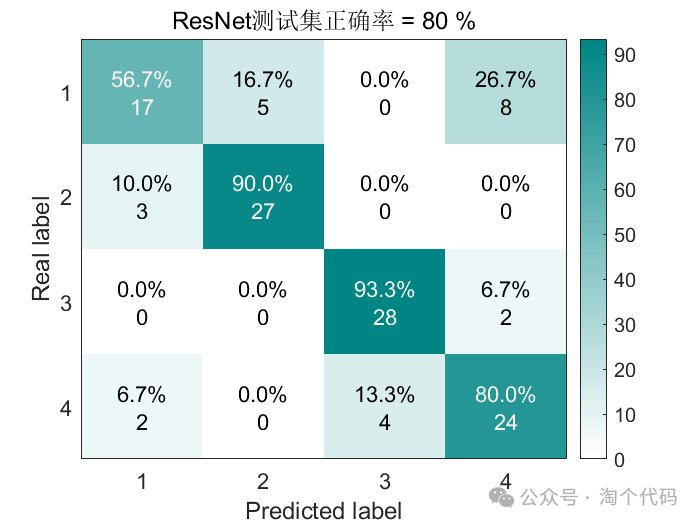

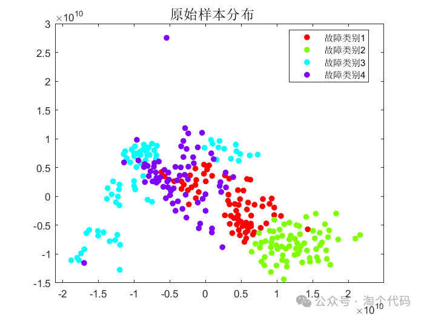
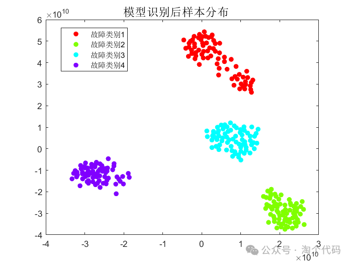
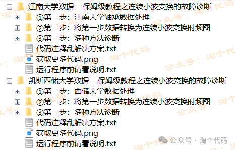

<!-- PAYMENT_BLOCK -->

## Get this dataset

- Payment link (Stripe): [Buy now](https://buy.stripe.com/3cs8yP7sY87d0vu9AB)
- Payment QR code: 

<!-- /PAYMENT_BLOCK -->
